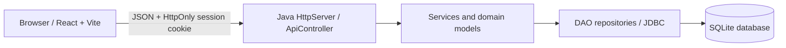

# DOSTATOK — Personal Financial Management System

DOSTATOK is a local personal finance application and Java OOP/DBMS college project. The React frontend talks to a plain Java `HttpServer`; Java services apply business rules and JDBC stores records in SQLite. The project uses manual JAR dependencies and `javac`/`java`, with no Maven, Gradle, or Spring Boot.

## Architecture



## Technology and prerequisites

- Windows, JDK 27 (the launcher requires `javac` and `java`), Node.js 24, npm.
- React 19 and Vite 8 in `frontend/`.
- SQLite JDBC 3.53.4.0 and Gson 2.11.0 in `backend/lib/`.
- SQLite data file: `database/dostatok.db` by default. Set `DOSTATOK_DB_PATH` to use another file. Set `-DDOSTATOK_PORT=...` to use a different backend port.

## Start the application

Run from the project root in the VS Code terminal:

```cmd
run-app.bat
```

The script compiles and starts the Java backend on port 8080 in the same terminal, then starts Vite on port 5173 and opens the default browser. The backend and frontend logs appear in that terminal. Use `Ctrl+C` to stop the foreground Vite process; stop the backend child with `Ctrl+C` in the same terminal if it remains active.

The launcher waits for the authentication API before starting Vite. If an older backend is already using port 8080, stop it first; the launcher reports the conflict instead of opening the frontend against an incompatible API.

Run the components separately when needed:

```cmd
cd backend
run.bat
```

```cmd
cd frontend
npm.cmd run dev
```

## Authentication and local security

Register with a name, email, and password of at least 12 characters. Passwords are stored as JDK `PBKDF2WithHmacSHA256` hashes with a fresh salt. The API issues an 8-hour, random, server-managed session in an HttpOnly, SameSite=Strict cookie. A user ID sent by the browser is never used as proof of ownership; the backend checks record ownership and linked account IDs.

The local server uses HTTP. Sessions are in memory and are cleared when Java restarts. If HTTPS terminates at a trusted proxy, start Java with `-DDOSTATOK_SECURE_COOKIES=true` to add the `Secure` cookie attribute. This project is intended for trusted local use and does not claim production-grade security or HTTPS protection. Do not expose it to the public internet.

## Database and demo-data cleanup

The first versioned migration adds the password hash column, removes the retired demo user and its cascaded fictional records, and sets SQLite `user_version` to 1. Startup does not execute `database/seed.sql`; that file is retained as a legacy example and must not be used with personal data.

Before migration, a timestamped backup was created at `database/dostatok-pre-implementation-20261014-223314.db`. Both that backup and the original database passed SQLite `integrity_check`; the backup contains the original demo records. To restore it, stop the backend, preserve the current `database/dostatok.db` under a new name, then copy the backup to `database/dostatok.db`. Database files are excluded from Git.

Example PowerShell restore, run from the project root after stopping Java:

```powershell
Copy-Item database\dostatok.db database\dostatok-before-restore.db
Copy-Item -Force database\dostatok-pre-implementation-20261014-223314.db database\dostatok.db
```

## Compile, test, and OOP demonstration

Compile all Java sources from `backend/`:

```powershell
$cp = 'lib\sqlite-jdbc-3.53.4.0.jar;lib\gson-2.11.0.jar'
javac -encoding UTF-8 -cp $cp -d out src\com\dostatok\controller\*.java src\com\dostatok\dao\*.java src\com\dostatok\database\*.java src\com\dostatok\exception\*.java src\com\dostatok\main\*.java src\com\dostatok\model\*.java src\com\dostatok\service\*.java src\com\dostatok\util\*.java
```

Run the isolated security/migration tests from `backend/`; the script copies the verified backup to a uniquely named temporary DB and removes that copy afterward:

```cmd
test-security.bat
```

The verified run passed 41 checks. Do not run the legacy `BackendTestSuite` against personal data; it assumes demo-seeded records and mutates its database.

Run the standalone OOP demonstration from the project root:

```cmd
java -cp "backend\out;backend\lib\sqlite-jdbc-3.53.4.0.jar;backend\lib\gson-2.11.0.jar" com.dostatok.main.OopDemo
```

Build the frontend from `frontend/`:

```cmd
npm.cmd run build
```

## Project structure

- `backend/src/com/dostatok/controller/` — HTTP routes and request handling.
- `backend/src/com/dostatok/service/` — authentication, sessions, validation, and application workflows.
- `backend/src/com/dostatok/model/` — domain objects and OOP examples.
- `backend/src/com/dostatok/dao/` — JDBC repositories.
- `backend/src/com/dostatok/database/` — database path and migrations.
- `frontend/src/` — React UI, API client, pages, and styles.
- `database/schema.sql` — relational schema; `database/seed.sql` — legacy demo fixture.
- `docs/` — database, OOP, testing, feature audit, and learning guides.

## Learning and remaining review

Start with [the Java OOP guide](docs/java-oop-concepts.md), then use the [viva guide](docs/java-oop-viva-guide.md) and [learning roadmap](docs/learning-roadmap.md). The [technology guide](docs/tech-stack-learning-guide.md) follows a request through the stack. The [feature audit](docs/feature-audit.md) lists tested areas and remaining manual/financial workflow review.

The new security suite covers registration, duplicate and invalid registration, login failure, sessions/logout, persistence, hash storage, unauthenticated requests, cross-user reads/updates/deletes for accounts, income, expenses, investments, assets, loans, and goals, loan repayments, account transactions, and transfers. Visual browser workflows, full CRUD validation, every financial formula, loan repayment accounting, and transaction rollback still need additional review.
