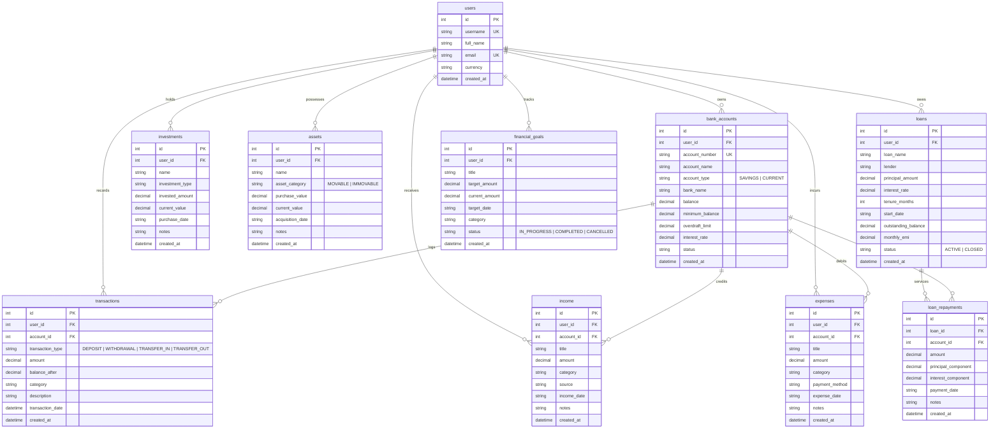

# DOSTATOK — Database Design & Schema Architecture

**Database Engine**: SQLite 3.53  
**Persistence Layer**: JDBC Driver (`org.sqlite.JDBC`) with `PRAGMA foreign_keys = ON;`  
**Storage Location**: `database/dostatok.db` (auto-created on startup)

---

## 1. Entity-Relationship (ER) Diagram

---

## 2. Table Specifications and Business Invariants

### 1. `users`
- Stores primary user identity and currency preferences.
- Default demo user seeded as `Aditya Sharma` (`INR`).

### 2. `bank_accounts`
- Core table backing the polymorphic `BankAccount` domain hierarchy.
- `account_type` column constrained to `SAVINGS` or `CURRENT`.
- `minimum_balance`: Enforced for `SAVINGS` accounts during withdrawals.
- `overdraft_limit`: Enforced for `CURRENT` accounts permitting negative balance down to `-overdraft_limit`.
- Atomic balance updates ensure no race conditions.

### 3. `transactions`
- Immutable ledger recording all monetary debits, credits, and transfers.
- Stores `balance_after` to preserve full audit trails.
- Linked to `bank_accounts(id)` with `ON DELETE CASCADE`.

### 4. `income` & `expenses`
- Operating cash flow records with categorization (Salary, Consulting, Food, Rent, Business).
- Optionally linked to a `bank_accounts(id)` for automated balance adjustments.

### 5. `investments`
- Capital market instruments (Mutual Funds, Equities, Gold, Fixed Deposits).
- Stores `invested_amount` and `current_value` to derive real-time capital gains and ROI.

### 6. `assets`
- Tangible physical capital divided into `MOVABLE` (Vehicles, Machinery, Electronics) and `IMMOVABLE` (Real Estate, Land).
- Enables calculation of gross physical wealth.

### 7. `loans` & `loan_repayments`
- Liabilities tracking borrowing, tenure, and amortization.
- `monthly_emi` pre-calculated using standard banking amortization formulas.
- Repayments reduce `outstanding_balance` atomically.

### 8. `financial_goals`
- Target-based savings milestones.
- Tracks `target_amount` and accumulated `current_amount` with safe division-by-zero protection.

---

## 3. Monetary Representation Standard

All monetary amounts are stored in SQLite using `DECIMAL(15,2)` and mapped into Java `BigDecimal` with 2 decimal places and `RoundingMode.HALF_UP`.
- **Zero Floating-Point Imprecision**: Binary `double` and `float` are strictly forbidden for financial calculations to prevent IEEE-754 rounding errors.
- **Indian Financial Localization**: Displayed across the UI using the `en-IN` numbering grouping convention (`₹1,50,000.00`).

