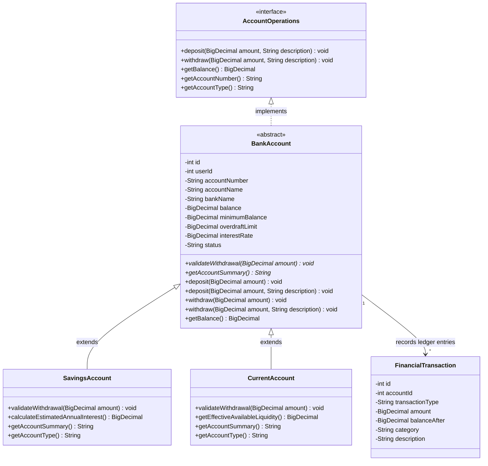

# DOSTATOK — Java Object-Oriented Programming (OOP) Mapping & Viva Guide

**Academic Course**: Object-Oriented Programming using Java & Database Management Systems  
**Project**: DOSTATOK — Personal Financial Management System  
**Evaluation Target**: College Faculty / Viva-Voce Committee

---

## 1. Executive Summary of OOP Concepts

DOSTATOK is intentionally engineered around the core Java OOP syllabus. Rather than treating Java solely as a web service backend, the financial business domain is structured using strict OOP design patterns, inheritance hierarchies, abstract classes, interfaces, and encapsulated financial invariants.

The table below provides a 1-to-1 mapping of required syllabus concepts to their exact source implementations.

---

## 2. Java OOP Concept Implementation Matrix

| # | OOP Concept | Source File & Class | Core Implementation Details | Academic Rationale in DOSTATOK | Practical Demonstration & Expected Output |
|---|---|---|---|---|---|
| **1** | **Classes & Objects** | [`User.java`](file:///d:/VS%20Code/DOSTATOK/backend/src/com/dostatok/model/User.java)<br>[`Investment.java`](file:///d:/VS%20Code/DOSTATOK/backend/src/com/dostatok/model/Investment.java) | Instantiation with `new`; private state; parameterized constructors; instance methods such as `getProfitLoss()`. | Encapsulates financial state and calculations within distinct domain models rather than untyped maps. | Run `OopDemo`: Creates `Investment` object, computes profit ₹12,500 and ROI +25.00%. |
| **2** | **Encapsulation** | [`BankAccount.java`](file:///d:/VS%20Code/DOSTATOK/backend/src/com/dostatok/model/BankAccount.java)<br>Lines 15–30 | All balance and credential fields are `private`. Balance has **NO** public setter. Controlled mutations via `deposit()` and `withdraw()`. | Financial balances cannot be modified arbitrarily; all mutations must pass positivity and business policy checks. | In `OopDemo`: Depositing negative amount (`-₹2,000`) throws `InvalidAmountException` and prevents state corruption. |
| **3** | **Inheritance** | [`SavingsAccount.java`](file:///d:/VS%20Code/DOSTATOK/backend/src/com/dostatok/model/SavingsAccount.java)<br>[`CurrentAccount.java`](file:///d:/VS%20Code/DOSTATOK/backend/src/com/dostatok/model/CurrentAccount.java) | `SavingsAccount extends BankAccount`<br>`CurrentAccount extends BankAccount` | Inherits common banking attributes (account number, balance, bank name) while specializing account policies. | Verifies `instanceof BankAccount` is `true` for both subclasses while retaining specialized fields. |
| **4** | **Abstraction (Abstract Class)** | [`BankAccount.java`](file:///d:/VS%20Code/DOSTATOK/backend/src/com/dostatok/model/BankAccount.java)<br>Lines 45–55 | Declared `public abstract class BankAccount`. Contains abstract method `validateWithdrawal(BigDecimal amount)`. | A generic bank account cannot exist without a specific product type and policy; forces subclasses to define withdrawal rules. | Calling `validateWithdrawal()` invokes the concrete subclass implementation enforced by the compiler. |
| **5** | **Interfaces** | [`AccountOperations.java`](file:///d:/VS%20Code/DOSTATOK/backend/src/com/dostatok/model/AccountOperations.java)<br>[`AccountRepository.java`](file:///d:/VS%20Code/DOSTATOK/backend/src/com/dostatok/dao/AccountRepository.java) | `public interface AccountOperations`<br>Defines contracts: `deposit()`, `withdraw()`, `getBalance()`. | Implements Dependency Inversion: Calling services depend on interface contracts rather than concrete SQLite implementations. | Invoking operations on `AccountOperations ops = new SavingsAccount(...)` decouples caller from implementation details. |
| **6** | **Runtime Polymorphism (Dynamic Dispatch)** | [`AccountService.java`](file:///d:/VS%20Code/DOSTATOK/backend/src/com/dostatok/service/AccountService.java)<br>Lines 135–155 | A collection of `List<BankAccount>` holds both `SavingsAccount` and `CurrentAccount` instances. Calling `acc.withdraw(...)` dynamically resolves at runtime. | Permits uniform transaction execution while respecting account-specific constraints (Minimum Balance vs. Overdraft). | Withdrawing ₹7,000 from ₹5,000 balance: Rejected on `SavingsAccount` (min balance breach); Approved on `CurrentAccount` (utilizes overdraft). |
| **7** | **Method Overloading** | [`BankAccount.java`](file:///d:/VS%20Code/DOSTATOK/backend/src/com/dostatok/model/BankAccount.java)<br>[`FinancialTransaction.java`](file:///d:/VS%20Code/DOSTATOK/backend/src/com/dostatok/model/FinancialTransaction.java) | Multiple methods sharing the same name with different parameters:<br>1. `deposit(BigDecimal amount)`<br>2. `deposit(BigDecimal amount, String description)` | Provides sensible defaults and ergonomic method overloading for developers and services. | Demonstrated in `OopDemo`: Calling both signatures updates account balance accurately with default or custom audit notes. |
| **8** | **Method Overriding** | [`SavingsAccount.java`](file:///d:/VS%20Code/DOSTATOK/backend/src/com/dostatok/model/SavingsAccount.java)<br>[`CurrentAccount.java`](file:///d:/VS%20Code/DOSTATOK/backend/src/com/dostatok/model/CurrentAccount.java) | Annotations `@Override` on `validateWithdrawal()`, `getAccountType()`, and `getAccountSummary()`. | Specializes generic base behavior with subclass mathematics (e.g. annual interest projection vs available credit limit). | In `OopDemo`: Subclasses print customized summary strings reflecting their distinct banking capabilities. |
| **9** | **Custom Exception Handling** | [`com.dostatok.exception.*`](file:///d:/VS%20Code/DOSTATOK/backend/src/com/dostatok/exception/) | Custom domain exceptions:<br>• `InsufficientBalanceException`<br>• `InvalidAmountException`<br>• `ResourceNotFoundException`<br>• `DatabaseOperationException` | Replaces generic runtime exceptions with domain-aware errors. Propagated through layers and converted to clean HTTP 400/404 responses. | When withdrawal exceeds funds, `InsufficientBalanceException` provides current balance and attempted amount without exposing stack traces. |
| **10** | **Package Hierarchy** | [`com.dostatok.*`](file:///d:/VS%20Code/DOSTATOK/backend/src/com/dostatok/) | Layered separation:<br>`main`, `model`, `dao`, `service`, `controller`, `database`, `exception`, `util` | Enforces clear Single Responsibility Principle across architectural tiers. | Zero cyclic dependencies; maintainable clean architecture. |

---

## 3. Class Hierarchy & Relationship Diagram



---

## 4. How to Execute the Live OOP Viva Demonstration

To present these concepts to faculty:

1. Open a terminal in `d:\VS Code\DOSTATOK`.
2. Run the command:
   ```bash
   java -cp "backend\out;backend\lib\sqlite-jdbc-3.53.4.0.jar;backend\lib\gson-2.11.0.jar" com.dostatok.main.OopDemo
   ```
3. The program prints a structured demonstration of all 9 concepts with inputs, state transitions, and exception validations.

