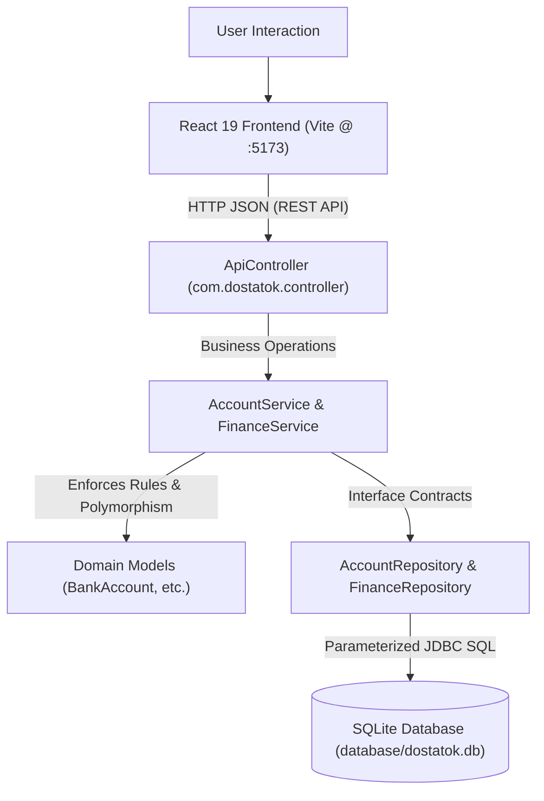

# DOSTATOK — Personal Financial Management System
## Comprehensive College Project Report & Documentation

**Academic Course**: Object-Oriented Programming (Java) & Database Management Systems (DBMS)  
**Project Name**: DOSTATOK (Достаток — Prosperity & Financial Well-being)  
**Target Completion**: October 2026  
**Team Composition**: 4 Students  

---

## 1. Abstract

**DOSTATOK** is a full-stack, enterprise-grade Personal Financial Management System engineered to demonstrate core Object-Oriented Programming (OOP) in Java and relational persistence using SQLite via JDBC. Built without heavy abstraction frameworks (no Spring Boot, Maven, or Gradle), the backend utilizes pure Java JDK primitives (`com.sun.net.httpserver.HttpServer`) to implement a robust multi-tiered REST architecture. The user interface is crafted with React 19 and Vite, styled in an elegant, modern fintech aesthetic featuring Indian Rupee (`en-IN`) formatting.

DOSTATOK consolidates bank accounts, simulated ledger transactions, operating cash flows (income/expenses), investment portfolios, capital assets, liabilities, and financial milestone goals into an automated Net Worth dashboard.

---

## 2. Problem Statement

Personal financial literacy and asset tracking are often fragmented across disparate bank passbooks, investment platforms, and spreadsheet templates. Individuals struggle to quantify their true consolidated financial health—often conflating gross cash inflows with net worth, overlooking loan amortization, or failing to enforce minimum balance reserves.

In the academic context, student software projects frequently degrade into generic CRUD portals without meaningful OOP domain modeling. DOSTATOK solves both challenges by providing:
1. A real-world financial balance sheet calculation engine (`Net Worth = Total Gross Assets − Total Liabilities`).
2. An OOP-centric domain architecture explicitly modeling bank account polymorphism (Savings vs. Current), encapsulation guards, interfaces, and atomic database transactions.

---

## 3. Project Objectives

- **OOP Mastery**: Demonstrate all 9 core Java OOP concepts (Classes, Encapsulation, Inheritance, Abstract Classes, Interfaces, Runtime Polymorphism, Overloading, Overriding, Exception Handling) in real financial workflows.
- **DBMS Rigor**: Design normalized 3NF relational schemas in SQLite with primary keys, foreign keys, check constraints, and cascade triggers.
- **Atomic Double-Entry Transactions**: Guarantee that deposits, withdrawals, and transfers update account balances and write transaction audit records atomically within single database transactions.
- **Production-Grade Fintech UI**: Deliver an intuitive, responsive dashboard using deep emerald and warm ivory design themes, Indian numbering grouping (`₹`), and real-time validations.
- **Zero Heavy Build Tool Dependencies**: Compile and run the Java backend using plain `javac` and `java` commands on Windows.

---

## 4. Scope and Limitations

### In Scope
- Consolidated Net Worth dashboard with automated asset allocation.
- Bank account management with polymorphic Savings (minimum balance rule) and Current (overdraft facility) accounts.
- Atomic simulated deposits, withdrawals, and inter-account transfers.
- Income and expense tracking with category classification and optional account linking.
- Capital investment tracking (Mutual Funds, Equities, Gold, Fixed Deposits) with profit/loss and ROI calculations.
- Physical asset management (Movable vs. Immovable properties).
- Loan and liability management with EMI calculation and repayment scheduling.
- Milestone-driven savings goals with completion percentage tracking.
- Dedicated standalone OOP Viva Demonstration console suite.

### Limitations & Out of Scope
- This application is a personal financial ledger and simulation tool; it does not connect to live banking networks (UPI, NEFT, RTGS) or initiate real-money bank transfers.
- Investment values are manually entered or simulated; no live stock market tickers are scraped.

---

## 5. System Requirements

### Hardware Requirements
- **Processor**: Intel Core i3 / AMD Ryzen 3 or higher
- **RAM**: 4 GB minimum (8 GB recommended)
- **Disk Space**: 200 MB free storage

### Software Requirements
- **Operating System**: Windows 10 / 11 (or macOS / Linux)
- **Java Development Kit**: JDK 21+ (Tested on JDK 27)
- **Node.js**: v20.x or higher (Tested on Node v24.21.0 & npm 11.19.0)
- **Database Engine**: SQLite 3.x (driver managed in `backend/lib/`)
- **Web Browser**: Google Chrome, Mozilla Firefox, or Microsoft Edge

---

## 6. Architecture & Data Flow



---

## 7. Java Package Structure

```
backend/src/com/dostatok/
├── main/
│   ├── App.java                   # Main HTTP Server bootstrap & dependency injection
│   ├── OopDemo.java               # Dedicated Live Viva Demonstration Suite
│   └── BackendTestSuite.java      # 10-point automated integration test suite
├── model/
│   ├── AccountOperations.java     # Interface defining public banking contract
│   ├── BankAccount.java           # Abstract base class
│   ├── SavingsAccount.java        # Subclass: Enforces min-balance & calculates interest
│   ├── CurrentAccount.java        # Subclass: Permissive overdraft liquidity
│   ├── FinancialTransaction.java  # Transaction ledger model with overloaded constructors
│   ├── User.java                  # User entity model
│   ├── Income.java                # Inflow cash model
│   ├── Expense.java               # Outflow expenditure model
│   ├── Investment.java            # Capital market investment model (Profit & ROI)
│   ├── Asset.java                 # Physical capital assets model
│   ├── Loan.java                  # Liabilities model with EMI calculations
│   ├── LoanRepayment.java         # Loan amortization installment model
│   ├── FinancialGoal.java         # Milestone goal model
│   └── DashboardSummary.java      # Consolidated balance sheet aggregation model
├── service/
│   ├── AccountService.java        # Atomic banking transactions, deposits, withdrawals
│   └── FinanceService.java        # Balance sheet mathematics & financial analytics
├── dao/
│   ├── AccountRepository.java     # Account persistence interface
│   ├── AccountRepositoryImpl.java # JDBC implementation mapping polymorphic accounts
│   ├── TransactionRepository.java # Ledger persistence interface
│   ├── TransactionRepositoryImpl.java
│   ├── FinanceRepository.java     # Financial entities persistence interface
│   └── FinanceRepositoryImpl.java
├── database/
│   └── DatabaseConfig.java        # Predictable path resolution & schema initialization
├── exception/
│   ├── DostatokException.java     # Base application domain exception
│   ├── InsufficientBalanceException.java
│   ├── InvalidAmountException.java
│   ├── ResourceNotFoundException.java
│   ├── DatabaseOperationException.java
│   └── ValidationException.java
└── util/
    ├── CurrencyUtil.java          # INR currency formatting and BigDecimal rounding
    └── JsonUtil.java              # Google Gson serialization wrapper
```

---

## 8. REST API Specification

| HTTP Method | Route | Description | Expected Status |
|---|---|---|---|
| `GET` | `/api/health` | Backend liveness and metadata probe | 200 OK |
| `GET` | `/api/dashboard/summary` | Consolidated balance sheet and recent activity | 200 OK |
| `GET` | `/api/accounts` | Fetch all user bank accounts | 200 OK |
| `POST` | `/api/accounts` | Create new Savings or Current account | 201 Created |
| `GET` | `/api/accounts/{id}` | Fetch account details | 200 OK |
| `POST` | `/api/accounts/{id}/deposit` | Atomic deposit + ledger entry | 200 OK |
| `POST` | `/api/accounts/{id}/withdraw` | Atomic withdrawal (checks polymorphic limits) | 200 OK / 400 Bad |
| `POST` | `/api/accounts/transfer` | Inter-account atomic transfer | 200 OK |
| `DELETE` | `/api/accounts/{id}` | Delete empty account | 200 OK |
| `GET` | `/api/transactions` | Full ledger statement audit trail | 200 OK |
| `GET` | `/api/income` | List all income streams | 200 OK |
| `POST` | `/api/income` | Record income (optional auto-deposit) | 201 Created |
| `DELETE` | `/api/income/{id}` | Delete income entry | 200 OK |
| `GET` | `/api/expenses` | List all expenditures | 200 OK |
| `POST` | `/api/expenses` | Record expense (optional auto-withdrawal) | 201 Created |
| `DELETE` | `/api/expenses/{id}` | Delete expense entry | 200 OK |
| `GET` | `/api/investments` | List investment holdings & calculate ROI | 200 OK |
| `POST` | `/api/investments` | Add new investment | 201 Created |
| `GET` | `/api/assets` | List physical capital assets | 200 OK |
| `POST` | `/api/assets` | Register physical asset | 201 Created |
| `GET` | `/api/loans` | List liabilities and EMI details | 200 OK |
| `POST` | `/api/loans` | Register new borrowing facility | 201 Created |
| `POST` | `/api/loans/{id}/repay` | Record loan repayment | 200 OK |
| `GET` | `/api/goals` | List financial milestones & progress | 200 OK |
| `POST` | `/api/goals` | Create financial goal | 201 Created |
| `POST` | `/api/goals/{id}/contribute`| Add funds toward milestone | 200 OK |

---

## 9. Five-Minute Demonstration Plan for Faculty Evaluation

| Time | Phase | Action & What to Show Faculty | Key Academic Point |
|---|---|---|---|
| **0:00 - 1:00** | **System Startup & Health** | Launch backend via `backend/run.bat` and frontend at `http://localhost:5173`. Show the green **Online (8080)** badge and Consolidated Net Worth dashboard. | Explain that backend runs in pure Java JDK without Spring or build tools; SQLite initializes automatically. |
| **1:00 - 2:00** | **Polymorphic Accounts & Banking** | Navigate to **Accounts & Ledger**. Show HDFC (Savings) and ICICI (Current). Deposit ₹10,000 to HDFC. Then attempt to withdraw an excessive amount (violating the ₹2,500 min balance). Show the rejection alert. Then withdraw on ICICI using its overdraft limit. | **Polymorphism**: Base `BankAccount.withdraw()` executes distinct algorithms on `SavingsAccount` vs. `CurrentAccount`. |
| **2:00 - 3:00** | **Cash Flow & Atomic Ledger** | Navigate to **Cash Flow**. Add a new Salary income and link to HDFC. Show how HDFC balance increments and a new ledger transaction appears automatically. | **Encapsulation & Atomicity**: Database transactions ensure balance update and ledger insert happen simultaneously or rollback together. |
| **3:00 - 4:00** | **Investments, Assets & Liabilities** | Review **Investments** (observe auto-calculated +25% ROI) and **Assets & Loans** (observe EMI calculation and repayment action). | **Mathematical Accuracy**: Calculations use `BigDecimal`, preventing floating-point rounding errors. |
| **4:00 - 5:00** | **Viva / Architecture Matrix** | Navigate to **OOP & Architecture** tab. Walk faculty through the 1-to-1 mapping table. Switch to terminal and run `java ... com.dostatok.main.OopDemo` to showcase the automated evaluation output. | Proves that OOP principles exist in genuine code, verified by automated unit tests. |

---

## 10. Team Contribution Plan (4 Students)

| Student Member | Primary Module & Area of Ownership | Specific Deliverables |
|---|---|---|
| **Student 1 (Full-Stack Lead)** | Backend Core & Architecture | • System bootstrap (`App.java`)<br>• OOP model hierarchy (`BankAccount`, `SavingsAccount`, `CurrentAccount`)<br>• Custom exceptions & `CurrencyUtil` |
| **Student 2 (Database & Persistence)** | DBMS & Repository Layer | • SQLite schema and indexes (`schema.sql`)<br>• `DatabaseConfig` connection manager<br>• `AccountRepository` and `TransactionRepository` JDBC implementations |
| **Student 3 (Financial Business Logic)** | Service Layer & Financial Mathematics | • `AccountService` atomic double-entry operations<br>• `FinanceService` Net Worth and EMI formulas<br>• Standalone test suites (`OopDemo`, `BackendTestSuite`) |
| **Student 4 (Frontend UI/UX)** | React 19 Client & Data Visualization | • Responsive UI design system (`dostatok.css`)<br>• Dashboard, Accounts, Cash Flow, and Goal pages<br>• SVG charts, modals, and API service integration |

---

## 11. Future Enhancements

1. **Multi-User Authentication**: Introduce salted PBKDF2 / BCrypt password hashing and JWT token authentication.
2. **Predictive Budget Alerts**: Implement automated alerts when monthly category expenditures exceed 80% of average income.
3. **Data Export**: Support exporting financial ledger statements to signed PDF and CSV formats.
4. **Recurring Automated Rules**: Simulated recurring monthly transactions (salary credit, automated SIP, rent debit).

